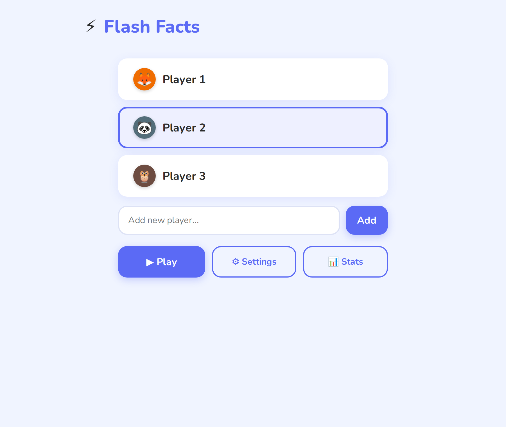
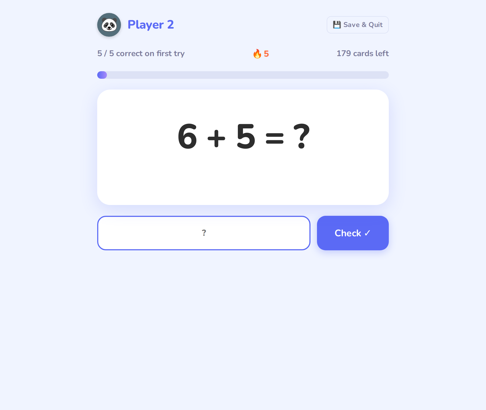
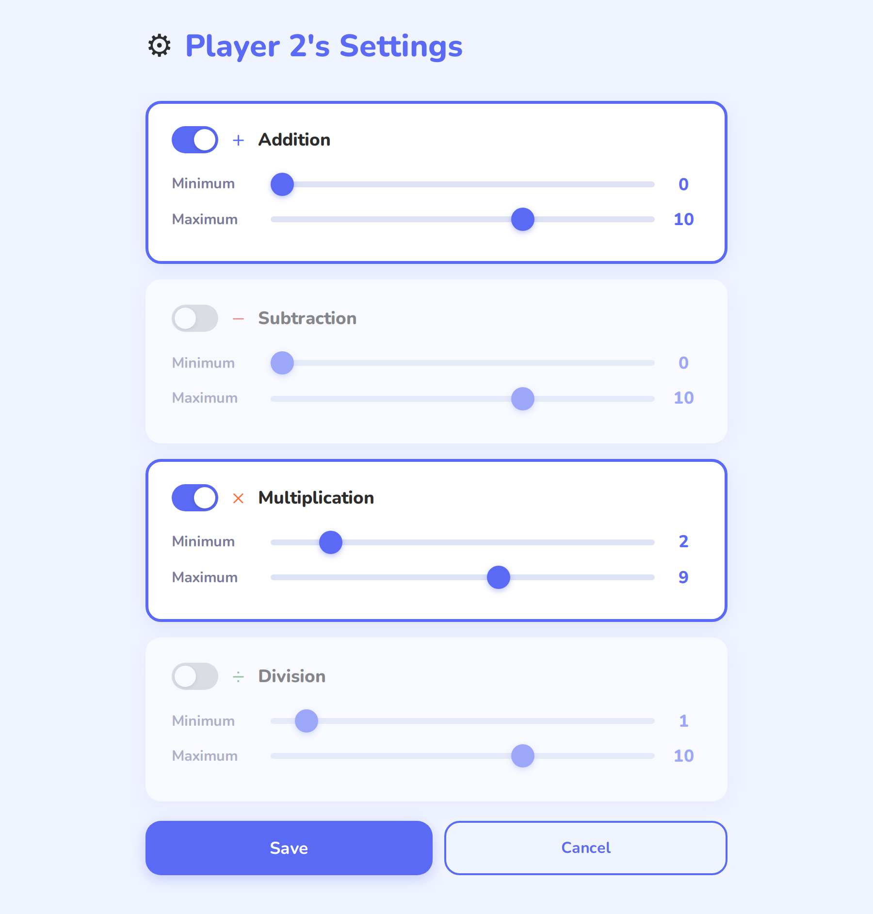
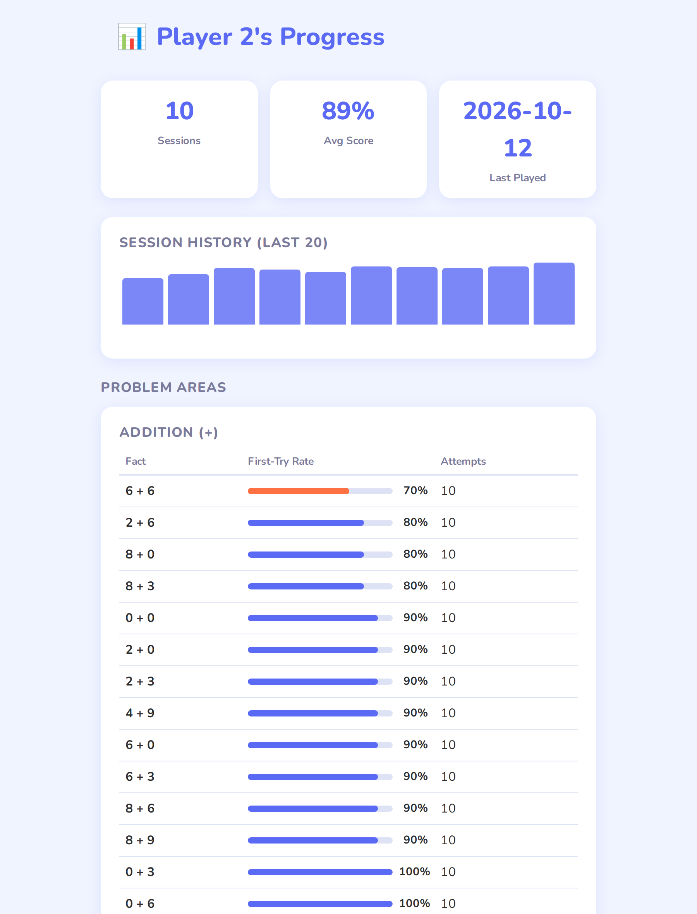
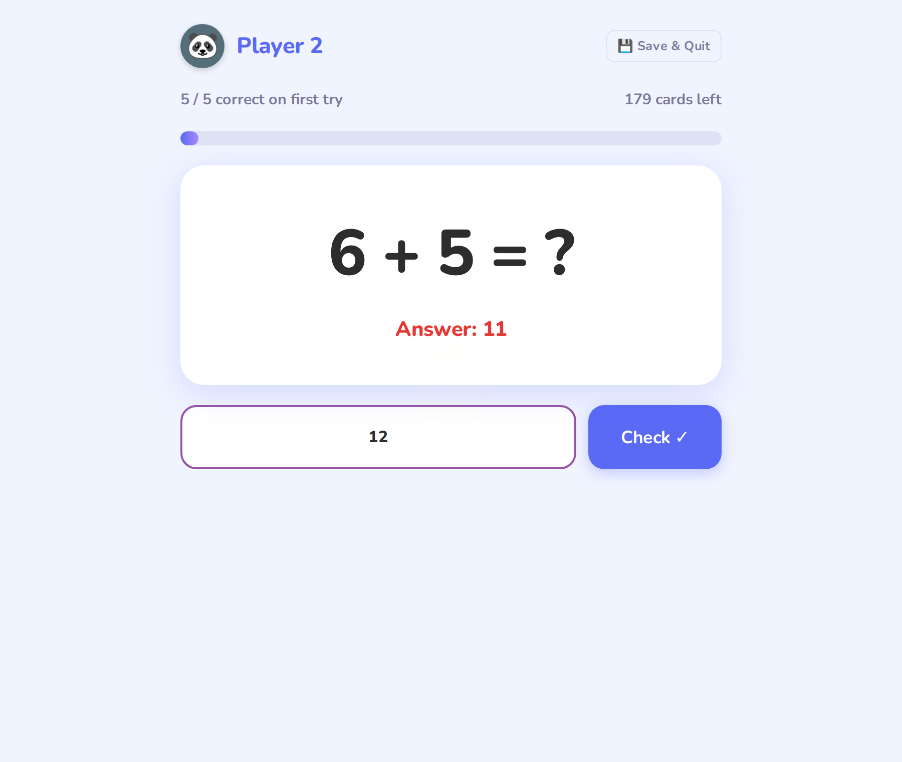

# Flash Facts ⚡

A math flashcard web app for kids. Each player has their own deck settings, practice continues until every card has been answered correctly, and a stats page shows which specific facts still need work.

I built it for my own kids. It runs in Docker on a home server and is in daily use.

| Pick a player | Practice |
|---|---|
|  |  |
| **Per-player settings** | **Progress and problem areas** |
|  |  |

## Features

- **Configurable decks.** Each player turns addition, subtraction, multiplication and division on or off and sets a min/max range for each. The deck contains every fact in range, shuffled with Fisher–Yates. Subtraction never goes negative, and division is generated from quotient × divisor, so every answer is a whole number.
- **Practice to mastery.** A wrong answer shows the correct one for 1.5 s, then the card goes back to the end of the deck. The session ends only when every card has been answered correctly. The score counts only *first-try* correct answers, so a fact that needed retrying still counts against it.
- **Never lose progress.** The session auto-saves every 10 correct answers. *Save & Quit* stores the full deck state, and the next *Play* offers to resume where you left off, showing % complete.
- **Problem-area stats.** First-try accuracy is tracked per fact (e.g. `7 × 8`), per player, across sessions. The stats page sorts facts from worst to best accuracy and colour-codes them, alongside a session-history chart.
- **Built for kids.** Large type, Enter to submit, sound and colour feedback, an answer-streak badge, and an animal avatar that reacts to each answer.



## Quick start

With Docker:

```bash
git clone https://github.com/falk225/flash_facts.git
cd flash_facts
docker compose up -d --build
```

Open http://localhost:8090. On first run, three demo players are created from `data/users.example.json`.

Without Docker (Python 3.12):

```bash
pip install -r backend/requirements.txt
python -m backend.app          # http://localhost:5000
```

## Architecture

```
frontend/  (vanilla JS, no build step)       backend/  (Flask)
  index.html    pick player          ──►  routes/accounts.py   GET/POST/DELETE /api/accounts
  config.html   per-player settings  ──►  routes/config.py     GET/PUT  /api/accounts/<id>/config
  session.html  the game loop        ──►  routes/sessions.py   POST /sessions, GET /stats,
  stats.html    progress + problems                            GET/PUT/DELETE /session-draft
                                           services/data_store.py
                                              └─ data/users.json  (fcntl-locked JSON file)
```

- **Frontend:** four static pages with plain `<script>` files (no framework, no bundler), served by Flask. Deck generation and the game loop run entirely in the browser (`deck.js`, `session.js`). The server is called only to load settings, save drafts, and record finished sessions.
- **Backend:** a small Flask JSON API in three blueprints. Gunicorn runs it in the container, and `/api/health` backs the Docker health check.
- **Storage:** a single JSON file, read under a shared `fcntl` lock and written under an exclusive one. It lives on a mounted volume, so data survives image rebuilds.

## Design decisions

- **A JSON file, not a database.** A household has at most five players, and writes happen only at session end, on draft saves, and on settings changes. A locked file means no database to run, and backups are simply copying a file. The trade-off is clear: it would not hold up to many concurrent writers or many users, and that is the point to move to SQLite.
- **Auto-save every 10 correct answers.** This came from real use: redeploying the app mid-session wiped a child's progress. Saving a draft at intervals was cheaper than making every answer a server write.
- **Score on first try, re-queue on miss.** Kids can always finish a session, but the score and the per-fact stats reflect what they actually know, not how many retries it took.
- **The frontend is baked into the image.** Static files ship inside the container, and only `data/` is a volume. A deploy is therefore always a rebuild, but the running app never mixes old and new frontend files.

## Configuration

| What | Where |
|---|---|
| Port | `docker-compose.yml` (`8090:5000`) |
| Players, settings, history | `data/users.json`. It is gitignored and created from `data/users.example.json` on first run. Players can also be added in the UI (max 5). |
| Desktop shortcut | `flash_facts_launcher.html`. Set `FLASH_FACTS_URL` to your server address. |

There is no authentication. The app is meant to run on a trusted home network.

## Status

Feature-complete for home use. Next up: a pytest suite for the API and data store, tests for deck generation, and CI. At the moment `deck.js` only runs a few console self-assertions when it loads.

## How it was built

Developed with AI pair-programming ([Claude Code](https://claude.com/claude-code)). Commits it co-wrote are marked in the history. The product decisions, testing with real users (my kids), and the deployment are mine.
